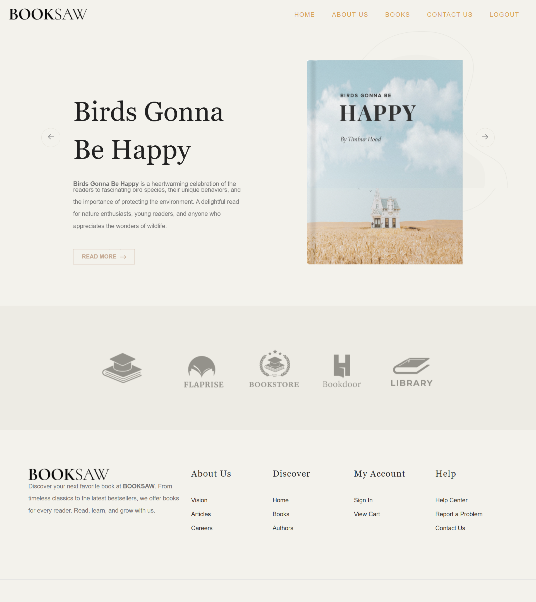
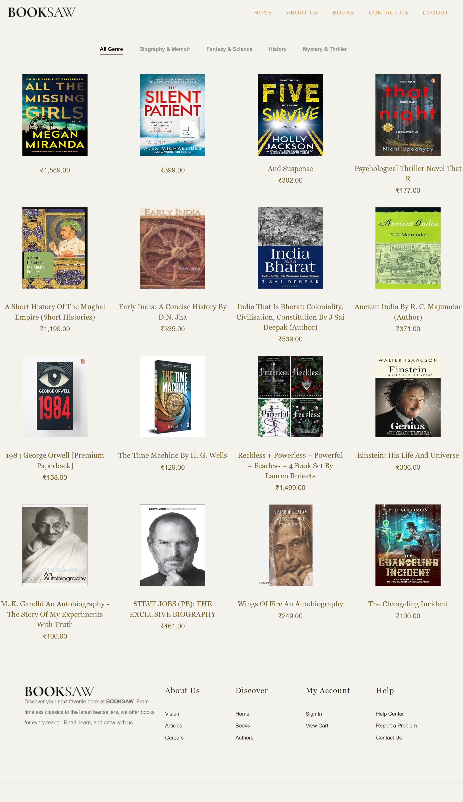
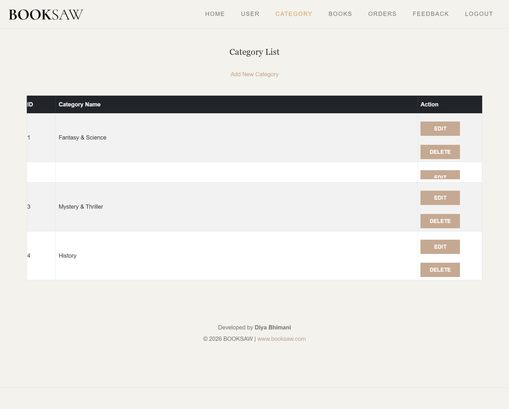

# 📚 BookSaw --- Bookstore Management System

A database-driven bookstore web application developed using **PHP,
MySQL, Bootstrap 5, HTML5, and CSS3**. The project demonstrates backend
development, database integration, CRUD operations, and responsive web
design.

## 📌 Table of Contents

-   [Project Overview](#-project-overview)
-   [Features](#-features)
-   [Technology Stack](#-technology-stack)
-   [Project Architecture](#-project-architecture)
-   [Project Structure](#-project-structure)
-   [Installation and Setup](#-installation-and-setup)
-   [How to Use](#-how-to-use)
-   [Database Structure](#-database-structure)
-   [Screenshots](#-screenshots)
-   [Challenges and Solutions](#-challenges-and-solutions)
-   [Skills Demonstrated](#-skills-demonstrated)
-   [Future Improvements](#-future-improvements)
-   [Project Links](#-project-links)

## 🎯 Project Overview

**BookSaw** is a PHP-based bookstore web application created to practice
and demonstrate practical web development skills.

The application uses PHP for server-side processing and MySQL for
storing and retrieving bookstore information. Bootstrap and custom CSS
provide the user interface, while database queries dynamically display
books and categories.

The project includes customer-facing pages and administrative
functionality for managing book records, categories, and customer
feedback.

### Project Objectives

-   Develop a database-connected web application.
-   Implement CRUD operations using PHP and MySQL.
-   Display book information dynamically.
-   Organize books by category.
-   Build responsive and user-friendly web pages.
-   Practice debugging, database management, and project documentation.

## ✨ Features

### Customer-Facing Features

-   **Book Catalog:** Display available books from the database.
-   **Category Filtering:** Browse books by category.
-   **Book Information:** Display book names, descriptions, prices, and
    images where implemented.
-   **About Page:** Display bookstore information.
-   **Contact Page:** Allow customers to submit messages.

### Administrative Features

-   **Category Management:** Add, view, and edit book categories.
-   **Book Management:** Add and edit book details, prices,
    descriptions, categories, and images.
-   **Feedback Management:** View and delete customer feedback records.
-   **Database Integration:** Store and retrieve information using PHP
    and MySQLi.
-   **Form Processing:** Handle submitted form data through PHP.

## 🛠️ Technology Stack

  Technology        Purpose
  ----------------- ------------------------------------------------
  PHP               Backend development and server-side processing
  MySQL             Database management
  MySQLi            PHP database connectivity
  HTML5             Web page structure
  CSS3              Styling and layouts
  Bootstrap 5.3.1   Responsive interface components
  JavaScript        Client-side interactions where implemented
  XAMPP             Local development environment
  Git and GitHub    Version control and source code hosting

## 🏗️ Project Architecture

The application follows a basic client-server architecture:

1.  **User / Administrator:** Accesses the application through a web
    browser.
2.  **Frontend:** HTML, CSS, and Bootstrap display the website
    interface.
3.  **PHP Backend:** Processes requests, forms, and application logic.
4.  **MySQL Database:** Stores book, category, and contact information.
5.  **Dynamic Output:** PHP retrieves database information and displays
    the results in the browser.

### Application Workflow

1.  The user opens a page in the browser.
2.  PHP executes the requested page.
3.  PHP retrieves or updates data through MySQLi.
4.  MySQL processes the database query.
5.  PHP generates the page content.
6.  The browser displays the result.

## 📁 Project Structure

The following structure represents the main project files. Adjust it to
match the files actually present in your GitHub repository.

-   **BookSaw/**
    -   `index.php`
    -   `books.php`
    -   `about.php`
    -   `contactus.php`
    -   `login.php`
    -   `connected.php`
    -   `category.php`
    -   `add_category.php`
    -   `edit_category.php`
    -   `add_book.php`
    -   `edit_book.php`
    -   `feedback.php`
    -   **css/**
        -   `normalize.css`
        -   `vendor.css`
        -   `style.css`
    -   **icomoon/**
    -   **images/**
    -   **js/**
    -   **screenshots/**
        -   `home.png`
        -   `books.png`
        -   `categories.png`
        -   `book-management.png`
    -   `README.md`

## ⚙️ Installation and Setup

### Prerequisites

-   XAMPP
-   A modern web browser
-   Git (optional)

### Step 1: Download the Repository

Visit the [BookSaw GitHub
Repository](https://github.com/DiyuBhimani/-BookSaw-PHP-Project-).

Select **Code → Download ZIP** and extract the downloaded project.

Alternatively, clone the repository using this command:

`git clone https://github.com/DiyuBhimani/-BookSaw-PHP-Project-.git`

### Step 2: Move the Project to XAMPP

Place the extracted project folder inside the XAMPP `htdocs` directory.

Typical Windows location: `C:\xampp\htdocs\BookSaw`

Make sure the PHP files and asset folders are inside the project
directory.

### Step 3: Start Apache and MySQL

1.  Open the XAMPP Control Panel.
2.  Start Apache.
3.  Start MySQL.

### Step 4: Create the Database

1.  Open [phpMyAdmin](http://localhost/phpmyadmin).
2.  Create a database named **`book`**.
3.  Select the `book` database.
4.  Import the project's SQL file if it is included in the repository.
5.  Verify that the required tables are available.

Expected table names:

-   `book`
-   `categories`
-   `contact`

If these tables already exist in your local database, you do not need to
create them again.

### Step 5: Configure the Database Connection

Open `connected.php` and verify your database settings.

For a default local XAMPP installation, the connection settings are
generally:

-   Host: `localhost`
-   Username: `root`
-   Password: Empty by default
-   Database: `book`

Make sure the connection variable matches the variable used in your
other PHP pages. For example, if your pages use `$con`, do not change it
to `$conn` without updating those pages.

The empty password is an example for a default local XAMPP installation.
Never publish production database credentials on GitHub.

### Step 6: Run the Application

Open this URL in your browser:

`http://localhost/BookSaw/`

To open the Books page directly:

`http://localhost/BookSaw/books.php`

The application should now run locally on your computer.

## 🚀 How to Use

### Browse Books

1.  Open the home page.
2.  Navigate to the Books page.
3.  View the available book listings.
4.  Select a category to filter the books.

### Manage Categories

1.  Open the category management page.
2.  Add a category.
3.  Edit an existing category.
4.  Verify the updated information.

### Manage Books

1.  Open the book management page.
2.  Enter the book name, description, price, and category.
3.  Upload an image if supported.
4.  Save the record and verify the result.

### Manage Customer Feedback

1.  Open the contact page.
2.  Submit a test message.
3.  Verify that the message is stored in the database.
4.  View or delete the record through the feedback management page, if
    implemented.

## 🗄️ Database Structure

**Database name:** `book`

The project uses the following database tables:

| Table Name | Description |
|---|---|
| `book` | Stores book details, including names, prices, images, and category identifiers. |
| `categories` | Stores book categories. |
| `contact` | Stores customer contact or feedback messages. |

### Database Relationship

The `categories` table stores book categories. The `book` table contains
a category identifier (`c_id`) to associate each book with its category.

The `contact` table stores customer messages submitted through the
contact page.

The exact columns and constraints depend on your database schema.

## 📸 Screenshots

Screenshots showcase the application running locally using XAMPP. A live
online demo is not currently available.

### Home Page

### Books Page

### Category Management

### Book Management

**How to add screenshots:**

1.  Run the project using XAMPP.
2.  Take screenshots of the actual pages.
3.  Create a `screenshots` folder in your project.
4.  Save your images using the filenames shown above.
5.  Upload the folder to GitHub.

Replace any image filename above if it differs from your actual
screenshot filename. GitHub image paths are case-sensitive.

## 🧩 Challenges and Solutions

The following are relevant development areas. Keep the descriptions that
accurately reflect your work.

  -----------------------------------------------------------------------
  Challenge                           Approach
  ----------------------------------- -----------------------------------
  PHP and MySQL connectivity          Configured a MySQLi connection to
                                      the `book` database

  Dynamic book listings               Retrieved records from MySQL and
                                      displayed them using PHP

  Category organization               Used category identifiers to
                                      associate books with categories

  Form handling                       Processed user input through PHP
                                      forms

  Book image management               Used image paths and upload
                                      handling where implemented

  Consistent page styling             Combined Bootstrap components with
                                      custom CSS

  Local development setup             Used XAMPP to run PHP and MySQL
                                      locally
  -----------------------------------------------------------------------

### Recommended Security Practices

-   Use prepared statements for queries involving user input.
-   Validate submitted form data on the server.
-   Escape output using `htmlspecialchars()` where appropriate.
-   Validate uploaded image types and sizes.
-   Protect administrative pages with authentication and authorization.
-   Keep private credentials out of the repository.

## 💡 Skills Demonstrated

-   **Backend Development:** PHP, server-side scripting, CRUD
    operations, and form processing.
-   **Database Management:** MySQL, SQL queries, MySQLi connectivity,
    and relational data.
-   **Frontend Development:** HTML5, CSS3, Bootstrap 5, and responsive
    layouts.
-   **Problem Solving:** Debugging, troubleshooting, and integrating
    frontend and backend components.
-   **Development Tools:** XAMPP, Git, GitHub, and browser testing.
-   **Documentation:** Markdown, installation instructions, and project
    organization.

## 🔮 Future Improvements

-   Implement secure login and role-based access control.
-   Add book search, sorting, and pagination.
-   Use prepared statements consistently.
-   Improve image upload validation.
-   Add automated testing for important workflows.
-   Implement shopping cart and order management features.
-   Improve accessibility and mobile responsiveness.
-   Deploy the application to a PHP/MySQL hosting service.
-   Add an entity-relationship diagram and sample database export.

## 🤝 Contributing

Suggestions and improvements are welcome.

1.  Fork the repository.
2.  Create a feature branch named `feature/your-feature`.
3.  Make your changes and test them locally.
4.  Commit your changes with a descriptive message.
5.  Push your branch and open a pull request.

Please do not commit passwords, private information, or unrelated files.

## 📄 License

No license has been specified for this project yet.

If you plan to make the project open source, choose an appropriate
license and add a `LICENSE` file. The MIT License is one common option
for projects that permit broad reuse under its terms.

Until a license is added, do not assume that others have permission to
reuse or redistribute the code.

## 👩‍💻 Project Summary

-   **Project Name:** BookSaw --- Bookstore Management System
-   **Project Type:** PHP and MySQL web application
-   **Database:** `book`
-   **Frontend:** HTML5, CSS3, Bootstrap 5
-   **Backend:** PHP and MySQLi
-   **Development Environment:** XAMPP
-   **Source Code:** [BookSaw GitHub
    Repository](https://github.com/DiyuBhimani/-BookSaw-PHP-Project-)
-   **Demo:** Runs locally using XAMPP

This project demonstrates practical experience in web development,
database integration, CRUD operations, responsive UI design, and
application troubleshooting.
